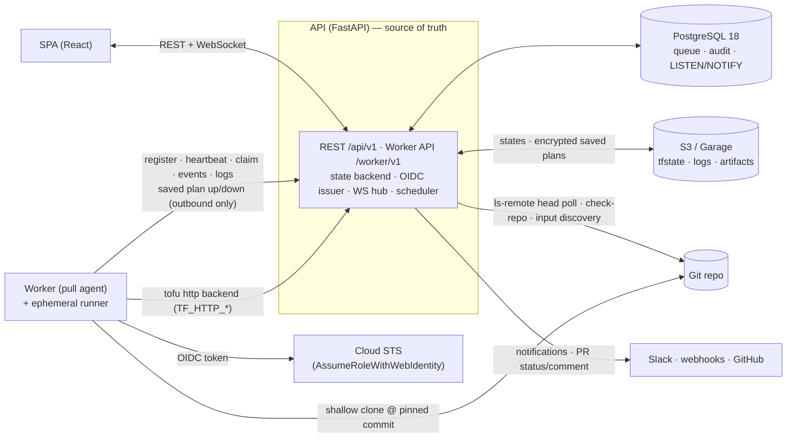
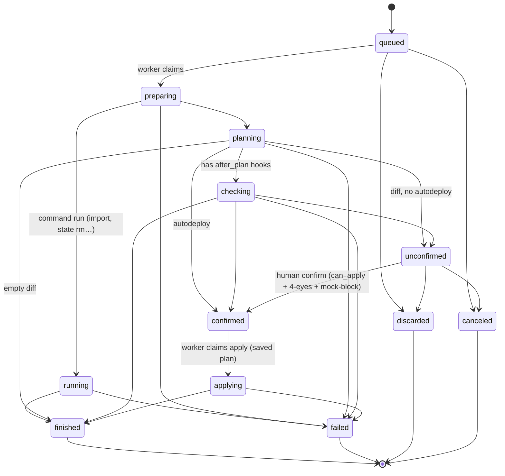
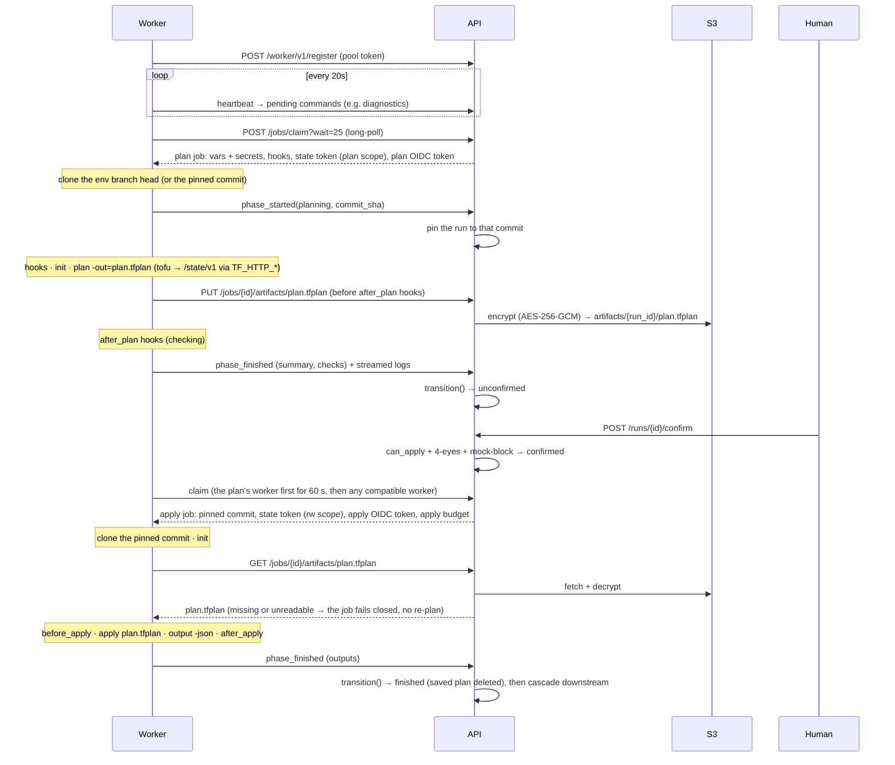
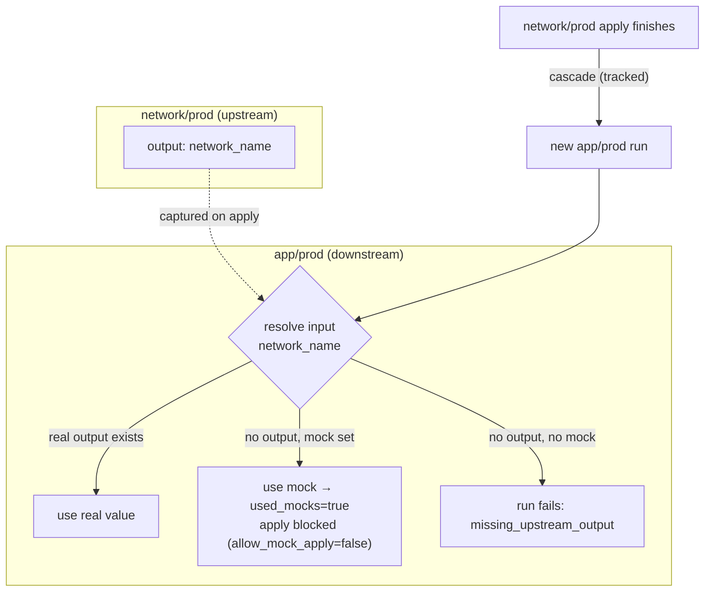
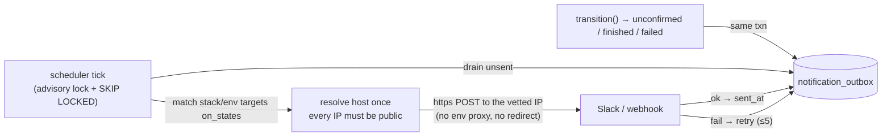
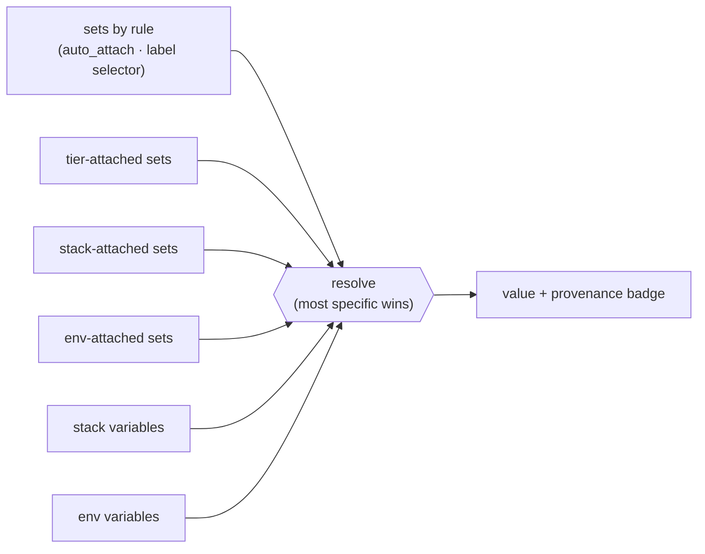

# Architecture

> The 10-minute tour of how Stackd works inside. [`SPECS.md`](SPECS.md) is the exhaustive technical
> truth; [`CONCEPTS.md`](CONCEPTS.md) explains each concept with worked examples.

## 🧭 System

**The API is the single source of truth. Workers have no inbound ports — they only pull.** The
queue is Postgres (`SELECT … FOR UPDATE SKIP LOCKED`), there's no broker, and Terraform talks to the
API's HTTP state backend rather than to S3 directly.

Only the API holds the S3 and database credentials: workers reach states and saved plans through
it.

## 🔄 Run state machine

Every state change goes through one function, `transition()`: it checks legality, does an atomic
guarded update, writes a `run_event` + (for human/terminal actions) an `audit_event` in the **same
transaction**, emits `LISTEN/NOTIFY`, and enqueues any notification. `checking` is skipped when
there are no `after_plan` hooks.

Not drawn: a closed pull request cancels its proposed runs from whatever in-flight state they are
in. A user cancels only `queued` or `unconfirmed` runs: stopping a job a worker is executing is not
implemented yet.

**Worker loss** fails only runs whose job is *executing* on the lost worker (`preparing`,
`planning`, `checking`, `running`, `applying`) — after 120 s, or, for a job holding apply
credentials (`applying`, a mutating command), after the apply budget + grace. `unconfirmed` and
`confirmed` runs are never reclaimed: they wait on a human or on the apply claim. Every terminal
transition drops the run's saved plan.

## 🤝 Worker pull protocol

One active run per environment (a partial unique index — the real concurrency guard); different
environments run in parallel. What a human confirms is the plan file the plan job made: the run is
pinned to the commit that plan checked out, and the apply job applies exactly that file.

**Per-job state tokens.** Each claim mints a state token for that job only, with a scope fixed at
mint time: `ro` (a PR or drift plan, a read-only command: read only, no lock), `plan` (a plan job:
read and lock while planning, never write), `rw` (an apply or a mutating command: write; TTL = the
apply budget + grace). A token whose run has ended can no longer write or lock. The worker hands it
to tofu only, as `TF_HTTP_*` environment variables — hooks never see it.

**Apply affinity.** A confirmed run is reserved for the worker that planned it for 60 s, then any
compatible worker takes it. Nothing is carried over in the workspace: the apply always starts from a
fresh clone of the pinned commit and the saved plan from the API.

## 🧬 Dependencies, mocks & cascade

At claim the API resolves each referenced input as **real upstream output › mock › explicit
error**. A run that consumed a mock is flagged `used_mocks` and can't be applied unless the env opts
in. When a tracked apply finishes, downstream environments cascade — protections are never bypassed.

## 🔔 Notifications — transactional outbox

`transition()` enqueues a row in `notification_outbox` in the same transaction (no I/O in the
request path). The scheduler drains it under an advisory lock with `FOR UPDATE SKIP LOCKED`, so a
rolled-back transition never notifies and two API replicas never double-send. No DB transaction is
held during the HTTP call.

The POST dials the address the SSRF check vetted, with Host, SNI and certificate checks on the
original hostname, so DNS rebinding can't redirect it to an internal host. It deliberately ignores
`HTTPS_PROXY` and other env proxies (a proxy would resolve the name again): an API whose only egress
is a proxy cannot deliver notifications. The PR status/comment post-back (`vcs_outbox`) follows the
same outbox pattern.

## 🗂️ Variable resolution

**Variables resolve in layers, with provenance** — the most specific layer wins, and the UI shows
*where* each value came from. Only variable sets of the environment's own space apply:

Upstream outputs and mocks (`dependency:`, `mock`) and external secret references are merged in at
claim time.

## 📈 Scaling

Workers are stateless pull agents, so **scaling out = running more of them** (e.g. bumping an ECS
service `desiredCount`). Postgres serializes claims with two guards (`FOR UPDATE … SKIP LOCKED` +
the `one_active_run_per_env` unique index). What's worth knowing:

- 🧩 **The unit of parallelism is the environment, not the worker** — one active run per env, but
  different envs run concurrently. Throughput ≈ `min(workers, envs with queued work)`.
- 🏷️ **Labels segment pools** — a worker only claims runs whose env labels are a subset of its own,
  so you can dedicate (and scale) a prod pool independently.
- ♻️ **Workers are interchangeable & disposable** — apply affinity prefers the worker that planned
  for 60 s, but the apply never depends on it (pinned commit + saved plan from the API). Losing a
  worker only fails the runs *executing* on it (`worker_lost`); runs waiting for a human or for the
  apply claim survive.
- 🔁 **Each worker runs `STACKD_MAX_CONCURRENT_JOBS` jobs at once** (default 1), always on
  different environments.
- 🗓️ **The scheduler runs in every API replica**, each task under its own advisory lock (held on a
  dedicated connection), so a task runs once per tick across replicas. The git head poll runs as a
  separate task (at most 8 `ls-remote` at a time), so slow repos never delay worker-loss detection
  or notifications.
- 📊 **No built-in autoscaler**, but `/api/v1/health` and `/queue` expose the signals an external one
  (ECS target-tracking, KEDA) can drive; `/metrics` serves Prometheus gauges. On Fargate, mind the
  runner execution model (no DinD).
