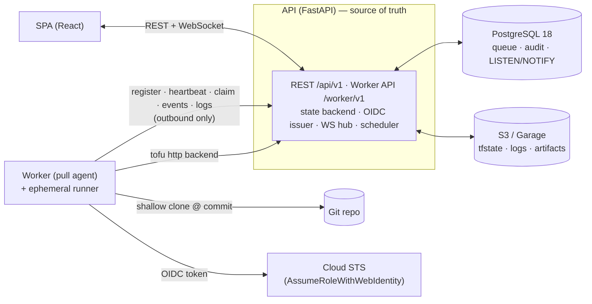
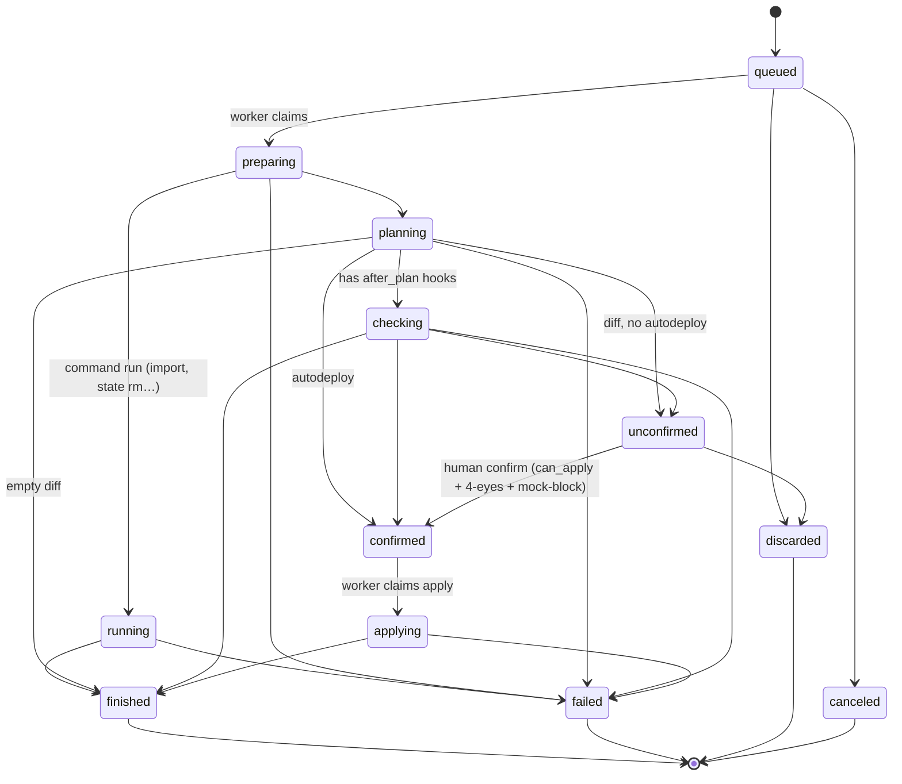
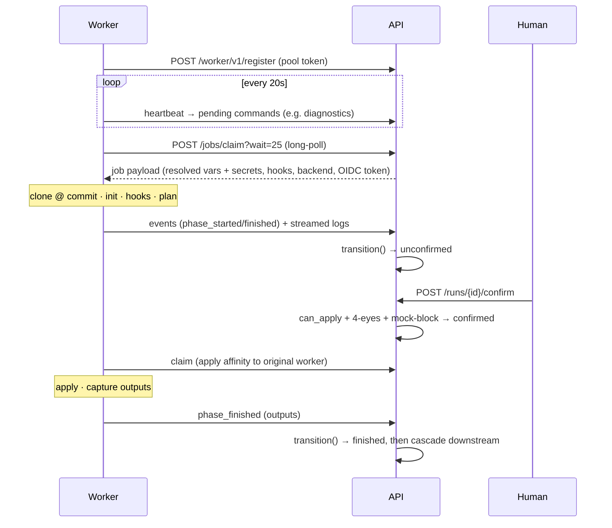
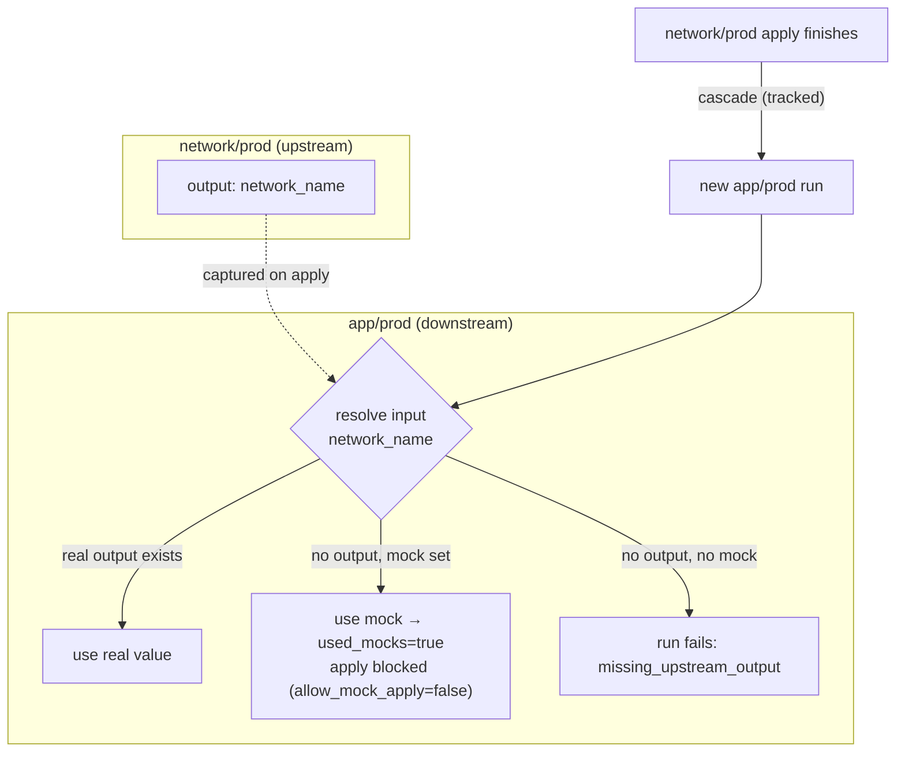
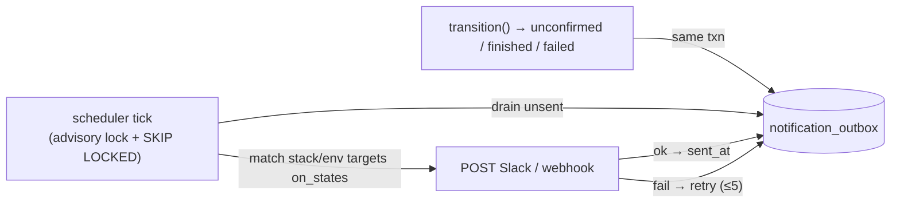
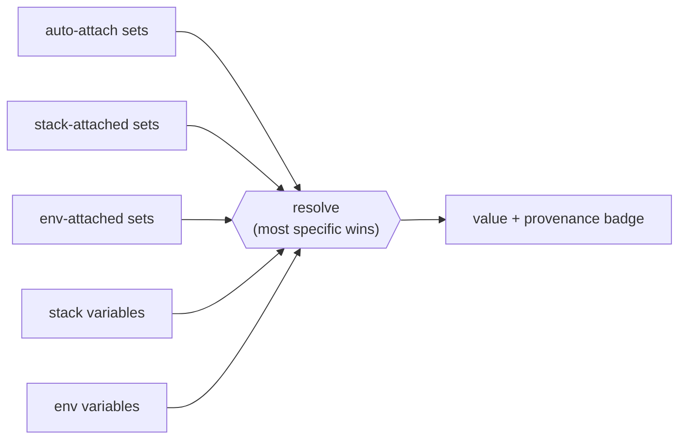

# Architecture

> The 10-minute tour of how Stackd works inside. [`SPECS.md`](SPECS.md) is the exhaustive technical
> truth; [`CONCEPTS.md`](CONCEPTS.md) explains each concept with worked examples.

## 🧭 System

**The API is the single source of truth. Workers have no inbound ports — they only pull.** The
queue is Postgres (`SELECT … FOR UPDATE SKIP LOCKED`), there's no broker, and Terraform talks to the
API's HTTP state backend rather than to S3 directly.

## 🔄 Run state machine

Every state change goes through one function, `transition()`: it checks legality, does an atomic
guarded update, writes a `run_event` + (for human/terminal actions) an `audit_event` in the **same
transaction**, emits `LISTEN/NOTIFY`, and enqueues any notification. `checking` is skipped when
there are no `after_plan` hooks.

## 🤝 Worker pull protocol

One active run per environment (a partial unique index — the real concurrency guard); different
environments run in parallel.

## 🧬 Dependencies, mocks & cascade

At claim the API resolves each referenced input as **real upstream output › mock › explicit
error**. A run that consumed a mock is flagged `used_mocks` and can't be applied unless the env opts
in. When a tracked apply finishes, downstream environments cascade — protections are never bypassed.

## 🔔 Notifications — transactional outbox

`transition()` enqueues a row in `notification_outbox` in the same transaction (no I/O in the
request path). The scheduler drains it under an advisory lock with `FOR UPDATE SKIP LOCKED`, so a
rolled-back transition never notifies and two API replicas never double-send.

## 🗂️ Variable resolution

**Variables resolve in layers, with provenance** — the most specific layer wins, and the UI shows
*where* each value came from:

## 📈 Scaling

Workers are stateless pull agents, so **scaling out = running more of them** (e.g. bumping an ECS
service `desiredCount`). Postgres serializes claims with two guards (`FOR UPDATE … SKIP LOCKED` +
the `one_active_run_per_env` unique index). What's worth knowing:

- 🧩 **The unit of parallelism is the environment, not the worker** — one active run per env, but
  different envs run concurrently. Throughput ≈ `min(workers, envs with queued work)`.
- 🏷️ **Labels segment pools** — a worker only claims runs whose env labels are a subset of its own,
  so you can dedicate (and scale) a prod pool independently.
- ♻️ **Workers are interchangeable & disposable** — apply affinity prefers the worker that planned,
  but expires; a lost worker's run is failed (`worker_lost`) by the scheduler.
- 📊 **No built-in autoscaler**, but `/api/v1/health` and `/queue` expose the signals an external one
  (ECS target-tracking, KEDA) can drive. On Fargate, mind the runner execution model (no DinD).
