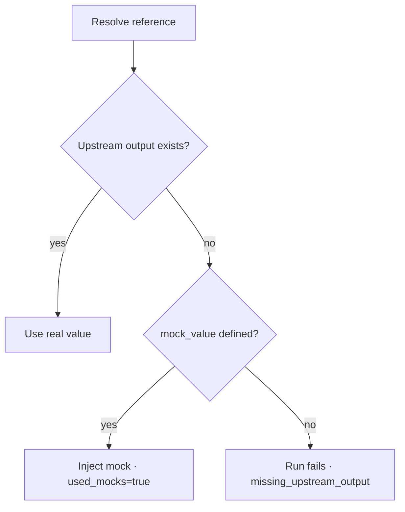

# Dependencies, outputs & mocks

Environments can depend on each other and pass **outputs** as inputs. An upstream
environment (e.g. `network/dev`) produces outputs; a downstream environment (e.g.
`app/dev`) consumes them as variables. This is what lets Stackd wire a whole stack
together and run it as a **cascade** — and what mocks let you bootstrap before the
first apply ever happens.

## Declare a dependency

A dependency is an edge `upstream env → downstream env` plus a list of
`output_references`. Each reference maps an upstream `output_name` (a Terraform
output) to a downstream `input_name` (a variable, without the `TF_VAR_` prefix), with
an optional `mock_value` (any JSON value: string, number, list, map).

```bash
curl -s -X POST localhost:8000/api/v1/environments/$APP_DEV/dependencies \
  -H "Authorization: Bearer $TOKEN" -H 'content-type: application/json' -d '{
    "upstream_env_id": "'"$NETWORK_DEV"'",
    "trigger_policy": "on_output_change",
    "references": [
      { "output_name": "network_name", "input_name": "network_name", "mock_value": "mock-network" }
    ]
  }'
```

Cycles are rejected at creation (`422`), and so is a second edge between the same two
environments (`409`). Beyond that, the only structural constraint is
`upstream <> downstream` — two environments **of the same stack** may depend on each
other (primary/secondary region pattern). To wire same-named environments across two
stacks in bulk, use the helper:

```bash
curl -s -X POST localhost:8000/api/v1/stacks/$APP_STACK_ID/dependencies/link-by-name \
  -H "Authorization: Bearer $TOKEN" -H 'content-type: application/json' \
  -d '{"upstream_stack_id": "'"$NETWORK_STACK_ID"'", "trigger_policy": "on_output_change"}'
```

It links each environment of the stack in the path to the same-named environment of
`upstream_stack_id`, skipping pairs already linked and any edge that would close a
cycle, and returns `{"created": N}` — running it twice is harmless. The edges it creates
carry **no** `output_references`, and there is no endpoint to edit an edge: to give one
references, delete it and re-create it with `POST …/environments/{id}/dependencies` as
above. Until then, an `on_output_change` edge has nothing to compare and only triggers a
downstream that has never finished a run (see [Cascade](#cascade)).

## How inputs resolve

Inputs are resolved fresh **at claim time** — at the plan claim and again at the apply
claim — and snapshotted into `resolved_inputs`. The rule is **real upstream output > mock >
explicit error**.



A `sensitive` upstream output is **never stored nor propagated**: a reference pointing
at one is a visible config error, never a silent null.

## Mocks & the apply block

Mocks solve the chicken-and-egg of bootstrapping a cascade: you can plan `app/dev`
with `network_name = "mock-network"` *before* `network/dev` has ever applied, just to
validate config. A run that injected a mock is flagged `used_mocks=true`, audited as
`dependency.mock_consumed`, and wears a violet `MOCKED` badge in the UI.

!!! warning "A mocked run cannot be applied"
    `unconfirmed → confirmed` is **refused** when `used_mocks=true` and the environment
    keeps the default `allow_mock_apply=false`. A mocked plan is for validation, not for
    real changes. Set `allow_mock_apply=true` on the environment to override. The gate is
    checked again at the apply claim: an input that falls back to a mock between confirmation
    and apply fails the run (`dependency_mock:mock_apply_disabled`). Mocked runs are never
    autodeployed; PR (`proposed`) runs use mocks freely since they are plan-only.

## Cascade

On a tracked apply finishing (`applying → finished`), Stackd upserts the run's outputs into
`env_outputs` (a `sensitive` one with no value, never propagated). It then walks the
outgoing edges and triggers downstream runs (`type=tracked`, `triggered_by=dependency`,
sharing a `run_group_id` — the triggering run's group, or the triggering run's own id):

| `trigger_policy` | behavior |
|---|---|
| `never` | downstream is never auto-triggered |
| `always` | downstream triggered on every finished upstream apply |
| `on_output_change` | triggered only if a referenced upstream output differs from the value the downstream's last finished run consumed (its `resolved_inputs`); a downstream that never finished a run is always triggered |

The run group is decided as a whole (SPECS §9.2):

- **All parents first.** A downstream waits until every upstream of the group that may still run
  has settled, then gets **at most one** run in that group, released by the last of them.
- **Only an applied upstream feeds a run.** The downstream runs if at least one upstream that was
  *applied* in the group passes its edge's policy; otherwise it is skipped. An upstream whose plan
  came back empty settles without triggering anything.
- **Stop on failure.** A run of the group ending `failed`, `discarded` or `canceled` — including
  one whose `after_apply` hook failed — triggers nothing, and no environment reachable from it
  gets a run in that group.

The group's status is computed on `GET /api/v1/runs/{id}` as `run_group: {id, status}`:
`running` while a run of the group is queued or active, then `partial_failure` if one failed,
was discarded or canceled, else `succeeded` (counting only the runs you can read).

!!! warning "Protections are never bypassed"
    A cascade run is routed like any other plan. It auto-confirms only on an `autodeploy`,
    unprotected environment, with no mock and no `warn` check; a **protected** downstream always
    stops at `unconfirmed` and waits for a human — see [Runs & approvals](runs-and-approvals.md).

!!! note "Cascades and environment rollouts"
    A run that belongs to an environment rollout never cascades: the rollout drives its members,
    and their downstreams outside the rollout are not triggered (they show as stale). A downstream
    that is a member of an **active** rollout gets no cascade run either — it is skipped in the
    group and the rollout plans it in its turn. If that member had already planned, the rollout's
    creator and approver get a `rollout_upstream_changed` in-app notification instead (SPECS §9.2,
    §21).

Launch a whole subgraph at once with `with_downstream: true` in the trigger body; the
root starts and subsequent levels follow via cascade:

```bash
curl -s -X POST localhost:8000/api/v1/environments/$NETWORK_DEV/runs \
  -H "Authorization: Bearer $TOKEN" -H 'content-type: application/json' \
  -d '{"with_downstream": true}'
```

## Inspect

```bash
curl -s localhost:8000/api/v1/environments/$APP_DEV/outputs      -H "Authorization: Bearer $TOKEN"
curl -s localhost:8000/api/v1/environments/$APP_DEV/dependencies -H "Authorization: Bearer $TOKEN"
curl -s localhost:8000/api/v1/graph                               -H "Authorization: Bearer $TOKEN"
```

`/outputs` lists a sensitive output with a `null` value. `/dependencies` lists the
environment's incoming edges; a reference shows `has_mock`, never the mock value itself.
`/graph` only shows the environments and edges of the spaces you can see. There is no
endpoint listing a run group's runs: follow a cascade on the graph page, through a run's
`run_group` and `parent_run_id` (`GET /api/v1/runs/{id}`), or through the downstream
environments' runs (`triggered_by: "dependency"`).

To remove an edge: `DELETE /api/v1/dependencies/{id}`.

## See also

- [Runs & approvals](runs-and-approvals.md)
- [Concepts](../CONCEPTS.md)
- [SPECS §9](../SPECS.md)
