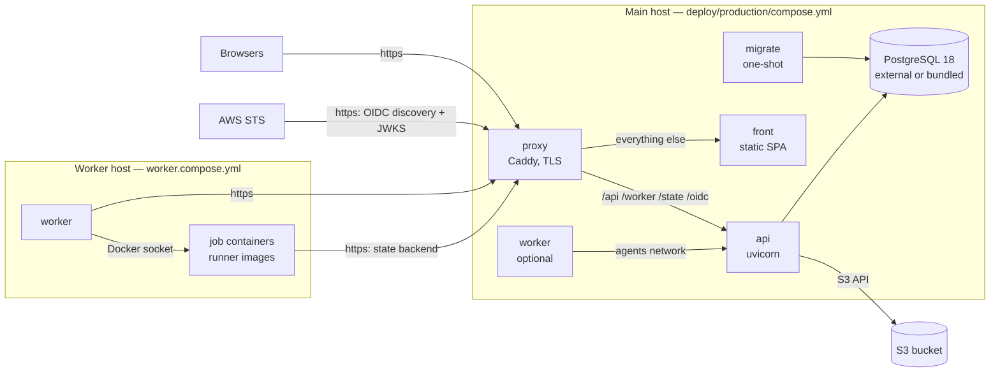

# Installing in production

This page installs Stackd on your own infrastructure with the **reference deployment**: production
images and a single-host Docker Compose file (`deploy/production/`), with workers on the same host
or on dedicated ones. For a local evaluation, use [Getting started](getting-started.md) instead —
it runs the dev stack, which must never be exposed.

## What gets deployed



| Service | Image | Role |
|---|---|---|
| `proxy` | `caddy` (official) | TLS (automatic HTTPS), the single public origin, routes the API prefixes, blocks `/metrics` |
| `front` | `front/Dockerfile` | the built SPA served by Caddy on `:8080`, fallback to `index.html` |
| `api` | `api/Dockerfile` | the API (REST, WebSocket, worker protocol, state backend, OIDC issuer, scheduler) |
| `migrate` | `api/Dockerfile` | one-shot: `alembic upgrade head`, then the bootstrap seed (`default` space + tier catalog) |
| `postgres` | `postgres:18` | optional (profile `bundled-postgres`) — an external server is recommended |
| `worker` | `worker/Dockerfile` | the agent; runs every tofu command in a container of a [runner image](#6-runner-images) |

The SPA and the API **must share one origin**: the session cookies are `SameSite=Strict` and
`Secure`, the SPA calls `/api/v1/…` and opens its WebSocket on `/api/v1/ws` on its own host. The
proxy routes by path:

| Path | Goes to | Notes |
|---|---|---|
| `/api/*` | api | REST and the `/api/v1/ws` WebSocket |
| `/worker/*` | api | worker protocol (long-poll claims) |
| `/state/*` | api | Terraform/OpenTofu HTTP backend — uses the `LOCK`/`UNLOCK` methods |
| `/.well-known/openid-configuration`, `/oidc/*` | api | the workload OIDC issuer: AWS fetches them over public https ([Cloud credentials](cloud-credentials.md)) |
| `/healthz` | api | liveness, for a load balancer or uptime check |
| `/metrics` | **404** | unauthenticated Prometheus endpoint: [scrape it internally](#monitoring) |
| everything else | front | the SPA |

The API image does not contain the dev login (`app/auth/dev.py` is deleted at build time), and the
API refuses to start in production on dev-grade settings (see [Configure](#3-configure)).

## Prerequisites

- **A Linux host** with Docker Engine 24+ and the Compose plugin **2.24+**. 2 vCPU / 4 GB is
  plenty for the API, the proxy and the SPA; size worker hosts for your Terraform runs.
- **A domain name** whose DNS points at the host, with ports **80 and 443** reachable from the
  internet: Caddy obtains and renews the certificate itself (Let's Encrypt / ZeroSSL). Behind a
  load balancer that terminates TLS, or with your own certificate, see [TLS options](#tls-options).
  The issuer must be reachable over public https anyway if you use AWS OIDC federation.
- **PostgreSQL 18** (the schema uses the native `uuidv7()`): a managed instance (RDS, Cloud SQL,
  Azure Flexible Server…) or your own. The `bundled-postgres` profile runs one on the host — fine
  for small installs, but backups and upgrades are then yours.
- **An S3 bucket** on any S3-compatible service (AWS S3, MinIO, Ceph, Garage, R2…), dedicated to
  Stackd, with **versioning on** and default encryption. It holds the managed states, the
  encrypted saved plans, archived logs and artifacts. On AWS, leave `S3_ACCESS_KEY`/`S3_SECRET_KEY`
  empty and the API uses the **AWS default credential chain** (instance profile, ECS task role,
  EKS IRSA / web identity…) — no long-lived key; elsewhere set a **static access key**. Either
  way, give it to a principal limited to that bucket. If the bucket
  does not exist, the API creates it on first write with versioning and SSE-S3 on.
- **A Google OAuth client** (Google Cloud console → *APIs & Services* → *Credentials* → *OAuth
  client ID*, type *Web application*) with the authorized redirect URI
  `https://<your domain>/api/v1/auth/google/callback`, and the Google Workspace domain(s) allowed
  to sign in. Google is the only login in production.
- **The OIDC signing key** of the workload issuer: an **AWS KMS** asymmetric key (`RSA_2048`,
  `SIGN_VERIFY`) with `kms:Sign` and `kms:GetPublicKey` for the API's AWS identity (an instance
  role, or `AWS_ACCESS_KEY_ID`/`AWS_SECRET_ACCESS_KEY` in `stackd.env`). Without AWS, you may keep
  the key in the database (encrypted with the master key) by acknowledging it:
  `STACKD_OIDC_SIGNER=local` + `STACKD_ALLOW_LOCAL_SIGNER=true` — see
  [Cloud credentials](cloud-credentials.md#the-signing-key).
- **Docker hosts for the workers** — the main host, or dedicated VMs (recommended: access to the
  Docker socket is root-equivalent, and the jobs run your repositories' code) — and **a container
  registry** for the runner images.

## 1. Get the images

Each [release](https://github.com/fmiquel90/stackd/releases) publishes the images to GitHub's
container registry, for `linux/amd64` and `linux/arm64`, signed with cosign:
`ghcr.io/fmiquel90/stackd/api`, `…/front`, `…/worker` and the OpenTofu runner image
`…/opentofu`. The release notes give each reference pinned by digest — use those, not a tag — and
the `cosign verify` command. The release also attaches `stackd-deploy-X.Y.Z.tar.gz`: this
directory (`deploy/production/`) as released, its `.env.example` and `worker.env.example` already
pointing at the release's images. Start from it rather than from a checkout of `main`.

To build them yourself instead (a fork, a patched build, an air-gapped registry), check out the
release tag, then build, tag and push the three images:

```bash
task build-images TAG=1.4.0 PREFIX=registry.example.com/stackd
docker push registry.example.com/stackd/api:1.4.0
docker push registry.example.com/stackd/front:1.4.0
docker push registry.example.com/stackd/worker:1.4.0
```

`task build-images` builds `api/Dockerfile`, `front/Dockerfile` and `worker/Dockerfile` for the
host's architecture (pass extra `docker build` arguments after `--`, e.g.
`task build-images -- --platform linux/arm64`). The base images are pinned by digest; behind a
registry mirror, override them with build arguments (`--build-arg PYTHON_IMAGE=…`, `UV_IMAGE`,
`NODE_IMAGE`, `CADDY_IMAGE`).

## 2. Prepare the database

With an external server, create the database and **two roles** — the schema owner, which runs the
migrations, and the application role, which cannot alter the audit trail — plus the audit purge
role (SPECS §6.1):

```sql
CREATE ROLE stackd_owner LOGIN PASSWORD '…';
CREATE ROLE stackd_app LOGIN PASSWORD '…';
-- the audit retention purge (optional: without it the audit trail is kept forever)
CREATE ROLE stackd_audit_purge LOGIN PASSWORD '…';
CREATE DATABASE stackd OWNER stackd_owner;

\connect stackd
ALTER SCHEMA public OWNER TO stackd_owner;
GRANT USAGE ON SCHEMA public TO stackd_app;
ALTER DEFAULT PRIVILEGES FOR ROLE stackd_owner IN SCHEMA public
  GRANT SELECT, INSERT, UPDATE, DELETE ON TABLES TO stackd_app;
ALTER DEFAULT PRIVILEGES FOR ROLE stackd_owner IN SCHEMA public
  GRANT USAGE, SELECT ON SEQUENCES TO stackd_app;
```

The migrations grant `stackd_audit_purge` what it needs on `audit_events`. After the **first**
migration (step 4), revoke the application role's right to rewrite the audit trail — a deployment
step no migration performs:

```sql
REVOKE UPDATE, DELETE ON audit_events FROM stackd_app;
```

Then `DATABASE_URL` (in `stackd.env`) uses `stackd_app`, `migrate.env` holds
`DATABASE_URL=postgresql+asyncpg://stackd_owner:…@…/stackd` (read by the `migrate` service only),
and `STACKD_AUDIT_PURGE_DATABASE_URL` uses `stackd_audit_purge`. URL-encode passwords that hold
reserved characters.

!!! note "Single role"
    One role for everything (as with the `bundled-postgres` profile, whose `stackd` user is a
    superuser) works: the append-only trigger still refuses any `UPDATE`/`DELETE` on
    `audit_events` by the application. The separate roles add the privilege boundary on top.
    The migrations create `stackd_audit_purge` without a login when it does not exist; to enable
    the purge there, `ALTER ROLE stackd_audit_purge LOGIN PASSWORD '…'` and set
    `STACKD_AUDIT_PURGE_DATABASE_URL`.

## 3. Configure

On the main host, from a checkout (or a copy of `deploy/production/`):

```bash
cd deploy/production
./init-env.sh
```

`init-env.sh` creates the env files from their examples and generates `STACKD_ENCRYPTION_KEY`
(AES-256 master key) and `STACKD_JWT_SECRET`; with the `bundled-postgres` profile in
`COMPOSE_PROFILES`, also the database password and `DATABASE_URL`. It never overwrites a value
already set. Then edit them — **one file per recipient**, so a secret cannot reach the wrong
container:

| File | Read by | Holds |
|---|---|---|
| `.env` | `docker compose` (interpolation) | `STACKD_DOMAIN`, image references, `COMPOSE_PROFILES`, `CADDY_GLOBAL_OPTIONS` (the ACME email), ports |
| `stackd.env` | `api`, `migrate` | every platform setting and secret: database, S3, master key, JWT secret, Google client, OIDC signer, timings |
| `migrate.env` (optional) | `migrate` | the schema owner's `DATABASE_URL` |
| `worker.env` | `worker` | API URL, pool token, runner images, job container limits — **never a platform secret** |

Each example file documents every variable. The API derives `STACKD_PUBLIC_URL` from
`STACKD_DOMAIN` (`https://<domain>`). In production it refuses to start unless:
`STACKD_ENCRYPTION_KEY` decodes to 32 bytes, `STACKD_JWT_SECRET` has at least 32 characters, the
public URL is `https://`, `STACKD_ALLOWED_DOMAINS` lists at least one domain, and the signer is
`kms` (or `local` with `STACKD_ALLOW_LOCAL_SIGNER=true`). The error names what is missing.

!!! danger "Back up `stackd.env`"
    `STACKD_ENCRYPTION_KEY` encrypts the sensitive variables, the secret source credentials, the
    saved plans and a local OIDC key. Lost, they are unrecoverable; never change it in place.
    Keep a copy outside the host (a password manager, a secret store). The files are created mode
    `0600` and ignored by git.

## 4. Start

```bash
docker compose up -d
docker compose ps
```

Compose runs `migrate` first (migrations, then the idempotent bootstrap: the `default` space and
the tier catalog — never the dev demo data), starts the `api` once it has succeeded, then the
`front` and the `proxy` once they are healthy. The proxy obtains the certificate on first start
(watch `docker compose logs proxy`).

Check from outside:

```bash
curl -fsS https://stackd.example.com/healthz                          # {"status":"ok"}
curl -fsS https://stackd.example.com/.well-known/openid-configuration  # the issuer
curl -s -o /dev/null -w '%{http_code}\n' https://stackd.example.com/metrics   # 404
```

## 5. The first admin

Set **`STACKD_BOOTSTRAP_ADMIN_EMAILS`** (in `stackd.env`) to the email(s) of the first
administrator(s): they become `admin` at their first sign-in, everyone else `reader` (SPECS §2.1).
Without it, the **first user to sign in becomes `admin`** — then sign in right after the first
start, before announcing the URL. Then promote the others in
**Settings → Users** (role, allowed tiers, destroy right) and scope them per space with the space
members. Only accounts of the `STACKD_ALLOWED_DOMAINS` Workspace domains can sign in at all.

For automation (CI triggering plans, scheduled configuration exports), create a **service
account** and an expiring API token (**Settings → Service accounts**) rather than using a
person's session — see [API › Authentication](../api.md#authentication). It reads and plans; it
never confirms an apply.

## 6. Runner images

Workers run every tofu/terraform command and every hook in a fresh container of a **runner
image** (`deploy/images/`: one IaC tool + git + jq, non-root, signature-verified downloads).
Workers pin each one by **digest** — they refuse tags. Each release publishes the OpenTofu image
of its pinned version (`ghcr.io/fmiquel90/stackd/opentofu`); its release notes give the
`STACKD_RUNNER_IMAGES` line below, ready to use. For another OpenTofu version, or for Terraform
(never published: BUSL), build the image for your workers' architectures and push it:

```bash
docker buildx build -f deploy/images/opentofu.Dockerfile \
  --build-arg OPENTOFU_VERSION=1.12.2 --platform linux/amd64,linux/arm64 \
  -t registry.example.com/stackd/opentofu:1.12.2 --push .
docker buildx imagetools inspect registry.example.com/stackd/opentofu:1.12.2   # Digest: sha256:…
```

```bash
# worker.env
STACKD_RUNNER_IMAGES={"opentofu:1.12.2": "registry.example.com/stackd/opentofu@sha256:…"}
```

A worker only takes runs whose stack `tool_version` matches one of its images. Add one entry per
version (and a Terraform image if you use it — BUSL, opt-in, see `deploy/images/README.md`).

!!! note "Private registry"
    The agent pulls a missing image through the Docker Engine API. For a private registry, give
    it a Docker config file holding the credential in `auths` — e.g. one `docker login` writes
    when no credential helper is configured:

    ```json
    {"auths": {"registry.example.com": {"auth": "<base64 of user:password>"}}}
    ```

    Mount it read-only into the worker (uncomment the volume in `worker.compose.yml`) and set
    `STACKD_REGISTRY_AUTH_FILE=/run/secrets/registry-auth.json` in `worker.env`. The entry
    matching the image's registry host (`registry.example.com:5000`, or Docker Hub's
    `https://index.docker.io/v1/`) is sent with that pull only; `username`/`password` and
    `identitytoken` entries work too. The file is re-read at each pull, so a job refreshing a
    short-lived token (ECR, GAR) can rewrite it. **Credential helpers (`credsStore`,
    `credHelpers`) are not supported.** The credential is never logged and never reaches a job
    container. Alternatively, pre-pull the images on each worker host
    (`docker pull <ref>@sha256:…`): the agent then finds them locally.

## 7. Workers

### Create a pool

As an admin, open **Workers** → *New pool* → *Create pool*, and copy the **pool token**: it is
shown once (stored hashed). Pools belong to a space; label one to dedicate its workers (e.g.
production) — see [Workers & scaling](workers-and-scaling.md#dedicate-a-pool-with-labels).

### A worker on the main host

Put the token and the runner images in `worker.env`, add `worker` to `COMPOSE_PROFILES` in `.env`
(e.g. `COMPOSE_PROFILES=worker`), then `docker compose up -d`. This worker reaches the API over
the internal `agents` network (`STACKD_API_URL=http://api:8000` is set by compose).

### Workers on other hosts

On each worker host (Docker Engine installed, nothing else):

```bash
mkdir -p /opt/stackd && cd /opt/stackd
# copy deploy/production/worker.compose.yml and worker.env.example (as worker.env)
$EDITOR worker.env    # STACKD_API_URL=https://stackd.example.com, the pool token, the images
docker compose -f worker.compose.yml up -d
docker compose -f worker.compose.yml logs -f    # → "registered"
```

Run as many as you need: they are stateless and only make outbound connections. The worker
appears on the **Workers** page; `STACKD_WORKER_NAME` gives it a readable name (default: the
container's hostname).

### What the docker runner needs

- **The Docker socket** (`/var/run/docker.sock`), mounted into the agent, which runs as root: it
  hands each workspace to the runner images' unprivileged user (uid 10001). Treat the host as
  privileged; rootless Docker and `STACKD_DOCKER_RUNTIME=runsc` (gVisor) harden it further.
- **The workspace root at the same path** on the host and in the agent: the job containers
  bind-mount each workspace by its host path. The compose files mount `STACKD_WORKSPACE_ROOT`
  (default `/var/lib/stackd/workspaces`) at the identical path — change both together through
  `.env`, never one side only.
- **A network that reaches the state backend.** Tofu, inside the job container, reads and writes
  the state through the API at `STACKD_INTERNAL_URL` — by default the public URL, which works from
  any host. The job containers use `STACKD_DOCKER_NETWORK` (default `bridge`): it must reach that
  URL and whatever your providers call; it is also where an egress allowlist belongs.
  On a single host whose containers cannot reach its own public address (no hairpin NAT), set
  `STACKD_INTERNAL_URL=http://api:8000` in `stackd.env` and `STACKD_DOCKER_NETWORK=stackd_agents`
  in `worker.env` — valid only while every worker runs on that host.
- **No platform secret.** `worker.env` must never hold `DATABASE_URL`, `S3_*`,
  `STACKD_ENCRYPTION_KEY`, `STACKD_JWT_SECRET` or `GOOGLE_CLIENT_SECRET` — the worker reaches
  states and plans through the API, and tofu and platform hooks inherit its environment.

A production API refuses a worker on any other runner (`STACKD_RUNNER=local`): the agent logs
`registration refused by the API` and retries slowly.

## Monitoring

`/metrics` is unauthenticated and blocked at the proxy. Scrape `http://api:8000/metrics` from a
Prometheus attached to the compose network (`docker network connect stackd_agents prometheus`, or
a compose override adding your Prometheus to `agents`). Set `STACKD_OTLP_ENDPOINT` to export
traces. Logs are JSON on stdout (`docker compose logs`). See [Observability](observability.md).

## Upgrading

Stackd upgrades are **migrate, then restart**; the migration runs before the new API starts:

1. Read the release notes (configuration changes, required steps).
2. Stop the workers (`docker compose stop worker`, and on worker hosts
   `docker compose -f worker.compose.yml stop`). A stopped worker **drains**: it takes no new
   job, lets its running ones finish and report, then exits — so `stop` can take as long as the
   longest running job, up to `STACKD_DRAIN_TIMEOUT_SECONDS` (20 min by default); past it, the
   remaining jobs are stopped and their runs fail with `worker_shutdown`. The compose files give
   the worker a `stop_grace_period` (`STACKD_WORKER_STOP_GRACE` in `.env`, default `23m` — raise it with the apply budget) so Docker does not kill it first; with plain Docker use
   `docker stop -t 1380 <container>` (the default 10 s would kill a running apply). Stop the
   workers **before** the API: a draining worker reports to it. A second `Ctrl-C`/signal stops
   the running jobs at once. See [Workers & scaling](workers-and-scaling.md#stopping-a-worker).
3. [Back up](backup-restore.md) the database (and keep `stackd.env`).
4. Point `.env` at the new release's image references (its release notes list them by digest, or
   rebuild them), then:

    ```bash
    docker compose pull          # registry images
    docker compose up -d         # migrate (one-shot) → api → front → proxy
    docker compose logs migrate  # "Running upgrade …", then "seed: spaces + tiers ensured"
    ```

    Compose re-runs `migrate` with the new image and only replaces the `api` once it succeeded;
    on a failed migration (each runs in a transaction) the `api` is not replaced and the error is
    in `docker compose logs migrate`. To run the migration alone: `docker compose run --rm migrate`.

5. Upgrade the workers to the same release (new `STACKD_WORKER_IMAGE`), then start them again.

Never edit an applied migration and never downgrade the database schema in place; restoring the
pre-upgrade backup is the way back.

## TLS options

- **Automatic HTTPS (default)**: Caddy obtains the certificate for `STACKD_DOMAIN`. Set
  `CADDY_GLOBAL_OPTIONS=email you@example.com` for expiry notices. Keep the `caddy_data` volume:
  it holds the certificates and the ACME account.
- **Your own certificate**: mount it into the `proxy` service with a compose override and add
  `tls /certs/fullchain.pem /certs/privkey.pem` to the site block of `deploy/production/Caddyfile`.
- **Behind a TLS-terminating load balancer**: point the load balancer at the proxy, add
  `trusted_proxies static <LB ranges>` to a `servers` global option so client addresses are kept,
  and keep the public URL `https://`. WebSockets, the `LOCK`/`UNLOCK` methods and long requests
  (a worker's claim waits 25 s) must pass the load balancer.
- **Tests / private networks**: `CADDY_GLOBAL_OPTIONS=local_certs` uses Caddy's internal CA —
  browsers, workers and AWS will not trust it.

## Security checklist

- [ ] `stackd.env` mode `0600`, backed up outside the host; `STACKD_ENCRYPTION_KEY` never rotated
      in place.
- [ ] `worker.env` holds no platform secret; workers on dedicated hosts.
- [ ] `STACKD_ALLOWED_DOMAINS` lists only your Workspace domain(s); you signed in first (admin).
- [ ] The OIDC signer is KMS, or `STACKD_ALLOW_LOCAL_SIGNER=true` is a deliberate choice.
- [ ] Only the proxy publishes ports (80/443); Postgres and the API are not reachable from
      outside; `/metrics` answers 404 publicly.
- [ ] The S3 bucket is private, versioned and encrypted; its key is scoped to that bucket.
- [ ] The application database role cannot `UPDATE`/`DELETE` `audit_events`; the purge role is
      configured (or the audit trail is kept forever on purpose).
- [ ] Runner images pinned by digest, built from `deploy/images/`, rebuilt for security updates.
- [ ] Job container limits set (`STACKD_DOCKER_MEMORY`, `STACKD_DOCKER_CPUS`) and an egress
      policy on `STACKD_DOCKER_NETWORK` if your threat model needs one.
- [ ] Database backups scheduled and a restore tested — see [Backup & restore](backup-restore.md).

## Kubernetes (future work)

There is no Helm chart yet (PLAN Phase 7). The same images map onto Kubernetes as follows; treat
this as a design sketch, not a supported install:

- **api**: a `Deployment` (several replicas are fine: the scheduler tasks take Postgres advisory
  locks, WebSocket fan-out goes through Postgres `LISTEN/NOTIFY`; the rate limits are per
  replica), a `Service`, the `stackd.env` settings as a `Secret`.
- **migrate**: a `Job` (or a Helm pre-upgrade hook) running `alembic upgrade head` and the
  bootstrap seed with the same image, before the API rolls out.
- **front**: a `Deployment` + `Service` of the front image (`:8080`).
- **Ingress**: one host; `/api`, `/worker`, `/state`, `/oidc`, `/.well-known/openid-configuration`
  and `/healthz` to the API, the rest to the front; WebSockets and the `LOCK`/`UNLOCK` methods
  allowed; `/metrics` not routed (a `ServiceMonitor` scrapes the Service).
- **Workers — the constraint**: the `docker` runner needs a Docker Engine socket and host-path
  workspaces at identical paths. Inside Kubernetes that means a dedicated node pool with a Docker
  Engine on the nodes and a `hostPath` workspace (privileged, root-equivalent), or a Docker-in-Docker
  sidecar sharing an `emptyDir` workspace mounted at the same path in both containers. A runner that
  starts a Kubernetes `Pod` per command does not exist yet; until it does, the simplest option is
  to keep the workers on VMs (as above) and run only the API and the front in the cluster. A
  worker pod drains on SIGTERM: give it `terminationGracePeriodSeconds: 1380` (drain timeout +
  cancel grace + 30 s) — the default 30 s would kill a running apply — and the registry
  credential as a read-only `Secret` volume (`STACKD_REGISTRY_AUTH_FILE`).

## Troubleshooting

| Symptom | Cause |
|---|---|
| `migrate` exits with `STACKD_ENV=production: …` | a setting the production check refuses — the message lists them |
| `migrate` cannot connect | `DATABASE_URL` (driver `postgresql+asyncpg://`, URL-encoded password); with an external server, the host's firewall |
| the proxy has no certificate | DNS not pointing at the host yet, or port 80/443 closed; `docker compose logs proxy` |
| Google sign-in fails with `redirect_uri_mismatch` | the OAuth client lacks `https://<domain>/api/v1/auth/google/callback` |
| a worker logs `registration refused by the API` | a production API refuses any runner but `docker` |
| a worker logs `register failed, retrying` (401) | a wrong pool token, or its pool was deleted |
| a run fails reaching `/state/v1/…` | the job containers cannot reach `STACKD_INTERNAL_URL` — see [What the docker runner needs](#what-the-docker-runner-needs) |
| a run fails `docker pull … failed: … unauthorized` / `pull access denied` | a private registry without a matching credential: set `STACKD_REGISTRY_AUTH_FILE` (an `auths` entry for the image's registry host), or pre-pull the runner images on the worker host |
| a worker refuses to start: `STACKD_REGISTRY_AUTH_FILE …` | the file is not mounted at that path, or is not valid JSON / its `auth` is not base64 `user:password` |
| a run fails `worker_shutdown: …` | its worker was stopped and the job outlived the drain timeout (or a second stop signal) |
