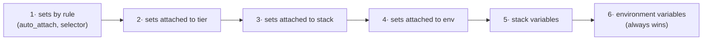

# Variables & secrets

Stackd composes the configuration of every run from layers. The same variable name can be defined in several places; the most specific layer wins, and every resolved value carries its **provenance** so you can see where it came from.

## The two kinds

Each variable has a `kind` that decides how the worker injects it:

| Kind (API) | In the UI | Injection |
|---|---|---|
| `terraform` | **Terraform variable**, shown as `var.<name>` | written to an auto-loaded tfvars file, present only while a tofu command runs (listed as `TF_VAR_<name>`); hooks only see it inside `plan.json` |
| `environment` | **Shell environment variable**, shown as `$NAME` | exposed as a plain process environment variable for the run: to tofu and hooks — to repo hooks only when it is not sensitive |

The UI never says just "environment" for the second kind: an *environment* is also a Stackd
environment (dev, prod…), which variable sets attach to. An `environment`-kind variable has nothing
to do with which environment it applies to; that is decided by where it lives (below).

A `terraform` variable is passed as a string; set `hcl: true` to write its value verbatim as an HCL
expression instead (a list, a map, a number…).

## Where a variable can live

- **Stack variable** — common to all environments of a stack (`environment_id` is null).
- **Environment variable** — scoped to a single environment.
- **Variable set** — a named, reusable bundle (e.g. `common-aws`, `datadog`, `region-eu`) that belongs to one space and that you attach to tiers, stacks or envs of that space. Set members are never scoped to an env directly; the *attachment* carries the targeting.

## Resolution order (6 layers)

At claim time the value of each variable is resolved from weakest to strongest. The strongest layer that defines a given `(name, kind)` wins.



| Layer | Source | Ordered by |
|---|---|---|
| 1 | variable sets that apply by rule: `auto_attach`, or a `selector` matching the env's labels | set name |
| 2 | variable sets attached to the env's **tier** | increasing `priority` |
| 3 | variable sets attached to the stack | increasing `priority` |
| 4 | variable sets attached to the env | increasing `priority` |
| 5 | stack variables | — |
| 6 | environment variables | — (always wins) |

Only sets of the environment's own space take part. A `selector` (`{"label": "value", …}`) matches an env whose effective labels (stack labels + env labels, env wins) contain every pair. Two more sources are merged in at claim time but sit outside this order: upstream outputs (`dependency:`) and mocks (`mock`) — see [Concepts](../CONCEPTS.md) and [SPECS](../SPECS.md) §9.

## Inspecting resolved values

`GET /environments/{id}/resolved-variables` returns the fully resolved set (layers 1–6; sensitive values masked `•••`), each entry tagged with its `injected_name` and `provenance`:

```bash
curl -s localhost:8000/api/v1/environments/$ENV/resolved-variables \
  -H "Authorization: Bearer $TOKEN" | jq
```

```json
[
  { "name": "region", "injected_name": "TF_VAR_region", "kind": "terraform", "sensitive": false,
    "hcl": false, "provenance": "set:region-us", "value": "us-east-1" },
  { "name": "cidr", "injected_name": "TF_VAR_cidr", "kind": "terraform", "sensitive": false,
    "hcl": false, "provenance": "env", "value": "10.9.0.0/16" }
]
```

The provenance snapshot is frozen onto the run (`variable_provenance`) for audit, and the UI uses it to show "inherited from `common-aws`", "overridden here" or `MOCK`.

## Variable sets

Create a set, add members, then attach it. `auto_attach: true` attaches it to every stack in the space; otherwise attach explicitly to a `tier`, `stack` or `environment`, with a `priority`. A set is created in the `default` space unless you pass `space_id`.

```bash
SET=$(curl -s -X POST localhost:8000/api/v1/variable-sets \
  -H "Authorization: Bearer $TOKEN" -H 'content-type: application/json' \
  -d '{"name":"common-aws","auto_attach":true}' | jq -r .id)

curl -s -X POST localhost:8000/api/v1/variable-sets/$SET/attachments \
  -H "Authorization: Bearer $TOKEN" -H 'content-type: application/json' \
  -d '{"target_kind":"environment","target_id":"'"$ENV"'","priority":10}'
```

### Attachments stay inside the set's space

A variable set only ever reaches its own space:

- A **stack** or **environment** attachment requires the target to live in the set's space, and you
  need `writer` on it. Otherwise the attach is refused: `400 Cross-space attachment` (or `403` when
  you can't write the target).
- A **tier** attachment (`target_id` = the tier's id from `GET /api/v1/tiers`) applies to that
  tier's environments **inside the set's space only**. Tiers are a global catalog; attaching
  `prod-credentials` to the `prod` tier never injects it into another space's prod environments.
- At resolution, an attachment from a set of another space is ignored, even one created before
  this rule existed.

!!! note
    Detach a set before deleting it. Deleting an attached set returns **409** with the list of attachments — explicit detachment is required. Deleting a stack, an environment or a tier removes the attachments that target it for you (audited `variable_set.detached` with the reason).

## Sensitive values

Mark a variable `sensitive: true` to make it write-only:

```bash
curl -s -X POST localhost:8000/api/v1/stacks/$STACK/variables \
  -H "Authorization: Bearer $TOKEN" -H 'content-type: application/json' \
  -d '{"kind":"environment","name":"DD_API_KEY","value":"super-secret","sensitive":true}'
```

The value is **AES-256-GCM encrypted at rest**, decrypted only to build the worker claim payload, and the agent masks the literal value in logs.

!!! warning
    A sensitive value is **never returned in clear**. A later `GET` shows `"value": "•••"`; the plaintext is not readable again through the API.

## The repo's own tfvars files

A repo that keeps one tfvars file per environment (`envs/prod.tfvars`, or `prod.tfvars` next to a
`prod.config` backend file) can keep it: list it in the environment's **`var_files`** (the
environment's settings, or the API). Paths are relative to the stack's project root, may go up
(`../shared/prod.tfvars`) but never out of the repository, and are used **in order** — a later file
wins over an earlier one.

```bash
curl -s -X PATCH localhost:8000/api/v1/environments/$ENV \
  -H "Authorization: Bearer $TOKEN" -H 'content-type: application/json' \
  -d '{"var_files":["envs/prod.tfvars","../shared/prod.tfvars"]}'
```

The worker passes each one as `-var-file=` to the plan (tracked, pull request, destroy, drift) and
to the `import` / `refresh` commands. **Stackd's variables always win**: every layer above, the
dependency outputs and the mocks override a repo file — the worker passes its own generated files
after yours. The order, weakest first:

| # | Source |
|---|---|
| 1 | `TF_VAR_<name>` in the environment |
| 2 | the repo's `terraform.tfvars` and `*.auto.tfvars` (auto-loaded) |
| 3 | `var_files`, in their order |
| 4 | Stackd's resolved variables (the 6 layers, dependency outputs, mocks) |

A file missing at the run's commit fails the run before anything executes, naming the file and the
environment. It works the same with managed and unmanaged state. Don't define the same variable in
both an auto-loaded repo file (layer 2) and a var file: the apply of the saved plan only sees the
auto-loaded value, and the tool may refuse the plan as an input mismatch. Details: SPECS §3.4.

## Values by reference (external secret sources)

Instead of storing a secret in Stackd, a variable can point at an entry in an external secrets manager (Proton Pass today). The value is fetched **live at run time** and never persisted — see [External secret sources](external-secrets.md).

## See also

- [Stacks & environments](stacks-and-environments.md)
- [External secret sources](external-secrets.md)
- [Concepts](../CONCEPTS.md)
- [SPECS](../SPECS.md) §3.4, §15
