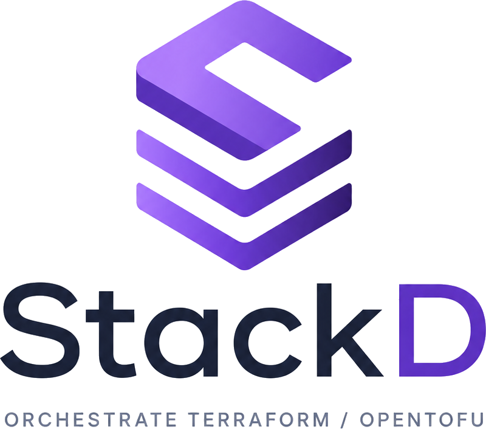

  <picture>
    <source media="(prefers-color-scheme: dark)" srcset="assets/logo-dark.png">
    
  </picture>

# Ship infrastructure changes with confidence

**StackD is a self-hostable control plane for
Terraform & OpenTofu:** every change becomes a reviewable **`plan → human approval → apply`** run,
executed on disposable pull-based workers, with a full audit trail and short-lived cloud
credentials minted for each job. The apply runs exactly the plan that was approved.

> No static cloud secrets. No shared state. No one running `apply` from their laptop.

## Why Stackd?

Running Terraform by hand doesn't scale: secrets live in CI variables, `apply` happens on
someone's machine, the state file is a shared landmine, and "who changed prod?" has no good
answer. Managed SaaS solves it — but you hand over your state, credentials, and audit log.

Stackd is the **self-hosted middle ground**: the API is the single source of truth, workers are
stateless and disposable, every state change is one auditable event, and cloud credentials expire
with the run.

## The model in one paragraph

A **space** holds **stacks**: a stack is your code (a Git repo and a folder). Each stack is deployed
as several **environments** (`dev`, `prod`…), each with its own state, variables and rules. Every
change to an environment is a **run**: plan, human review, apply. A worker executes a run as
**jobs** — a plan job, then an apply job once someone confirms. Each environment's **tier** decides
who may confirm.

## Start here

- 🚀 **[Getting started](guide/getting-started.md)** — bring the stack up and drive your first run.
- 🧱 **[Stacks & environments](guide/stacks-and-environments.md)** — the template/instance model.
- 🛡️ **[Runs & approvals](guide/runs-and-approvals.md)** — tiers, four-eyes, the apply gate.
- 🪝 **[Hooks & `.stackd.yml`](guide/hooks.md)** — platform and repo hooks.
- 📥 **[Importing an existing stack](guide/importing-existing-state.md)** — adopt existing remote state.
- 🔑 **[Cloud credentials (OIDC)](guide/cloud-credentials.md)** — per-job roles, no static keys.
- 🏗️ **[Architecture](ARCHITECTURE.md)** — how it works inside, with diagrams.

New to the model? The **[Concepts](CONCEPTS.md)** guide starts with a one-page glossary, then
explains everything with worked examples. For the exhaustive technical truth, see the
**[Specification](SPECS.md)**.
